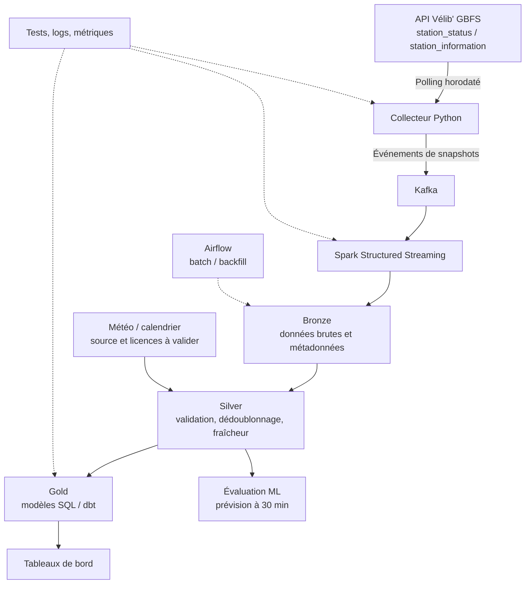

# Grand Paris Mobility Lakehouse

**Plateforme expérimentale de Data Engineering pour la disponibilité des vélos partagés.**  
*Projet personnel, pédagogique et reproductible — état actuel : cadrage scientifique et architecture cible (aucun pipeline de production n'est encore livré).*

## 1. Problématique

**Question de recherche :** Comment concevoir, instrumenter et évaluer une plateforme Data Lakehouse qui collecte des états de stations Vélib', fiabilise des données temporelles et soutient une prévision de disponibilité à horizon court ?

Ce dépôt vise deux résultats distincts : (1) un système d'ingénierie des données reproductible, (2) une évaluation expérimentale transparente de ses compromis et, à terme, de modèles prédictifs.

> **Limite fondamentale :** le flux public décrit des **instantanés de disponibilité des stations**, **pas des trajets individuels**. Une variation du nombre de vélos disponibles n'est pas une mesure certifiée des locations ou retours.

## 2. Architecture cible (non encore implémentée)



**Attention :** le fournisseur Vélib' expose un point de consultation HTTP. Le *streaming* est créé par notre collecte régulière et la publication d'événements dans Kafka ; l'API n'est **pas** intrinsèquement un flux Kafka ni un journal de trajets.

## 3. Objectifs scientifiques

- **Fiabilité :** caractériser données manquantes, duplications, états obsolètes, interruptions et reprise.
- **Performance :** mesurer débit utile, latence bout en bout et ressources sur une machine contrainte.
- **Reproductibilité :** documenter code, versions, configuration, paramètres, protocole et résultats bruts.
- **Prévision :** comparer des *baselines* temporelles à des modèles plus élaborés, uniquement avec des données disponibles à l'instant de prédiction.

Voir [question et hypothèses](docs/research/01_problem_statement.md) et [protocole d'évaluation](docs/experiments/00_evaluation_protocol.md).

## 4. État de réalisation

| Composant | État | Preuve |
|---|---|---|
| Audit machine / Docker | ✅ Vérifié localement | [Journal d'audit](docs/setup/01_environment_validation.md) |
| Définition scientifique | 📄 Rédigée | [Problématique](docs/research/01_problem_statement.md) |
| Architecture cible | 📄 Proposée | [Décisions](docs/architecture/01_target_architecture.md) |
| Collecteur et jeu de données | ⏳ Non implémentés | — |
| Kafka / Spark / Lakehouse | ⏳ Non implémentés | — |
| Tests automatisés / CI | ⏳ Non implémentés | — |
| Dashboards / modèle ML | ⏳ Non implémentés | — |

## 5. Structure du dépôt

```text
grand-paris-mobility-lakehouse/
├── README.md
├── CHANGELOG.md
├── .gitignore
├── .editorconfig
├── .github/
│   └── PULL_REQUEST_TEMPLATE.md
├── docs/
│   ├── architecture/
│   ├── decisions/
│   ├── experiments/
│   ├── git/
│   ├── research/
│   ├── setup/
│   └── sources/
├── scripts/
│   └── setup/
│       └── check_environment.ps1
└── src/  (créé au démarrage de l'ingestion)
```

## 6. Reproductibilité et confidentialité

- Les fichiers de données collectées, secrets, `.env`, sorties d'expériences et rapports locaux ne sont pas suivis par Git.
- Les résultats chiffrés seront publiés **seulement après mesure**, avec paramètres, versions, commande de reproduction, date et limites.
- Une vérification des droits de réutilisation sera réalisée avant toute redistribution de données brutes.
- L'architecture sera activée **par étapes** pour respecter la RAM disponible ; un outillage nombreux ne garantit pas une meilleure solution.

## 7. Sources et navigation

- [Vélib' Métropole — documentation officielle des données GBFS](https://www.velib-metropole.fr/donnees-open-data-gbfs-du-service-velib-metropole)
- [Documentation des sources et du contrat de données](docs/sources/01_velib_gbfs.md)
- [Audit de l'environnement](docs/setup/01_environment_validation.md)
- [Workflow Git et contributions](docs/git/01_git_workflow.md)
- [Journal des versions](CHANGELOG.md)

**Prochaine étape :** construire un collecteur HTTP **minimal, testé, idempotent et horodaté** avant d'introduire Kafka. Toute autre fonctionnalité reste une cible, et non une réalisation revendiquée.
