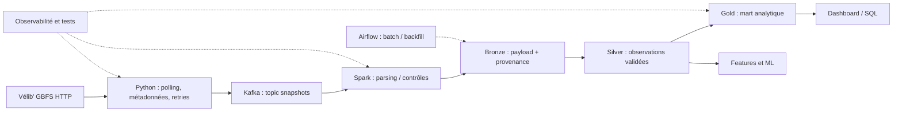

# 01 — Architecture cible et séquencement

**Attention : architecture proposée, non déployée.** Les composants seront introduits uniquement lorsqu'un besoin mesuré le justifie.

## Pourquoi ne pas tout démarrer en même temps ?

Le matériel d'expérimentation possède 15,9 Go de RAM. Une plateforme complète Kafka + Spark + Airflow + MinIO + PostgreSQL peut créer une contention artificielle et fausser les mesures. On doit introduire, isoler et mesurer chaque service.

## Séquence de livraison

1. **MVP ingestion :** collecte HTTP robuste, schéma d'entrée, métadonnées temporelles, tests unitaires, données locales.
2. **Messaging :** publier chaque snapshot dans Kafka avec clé, idempotence et politique de rétention explicites.
3. **Traitement :** comparer Python batch à Spark Structured Streaming ; mesurer coûts et bénéfices réels.
4. **Lakehouse :** Bronze immutable/logique, Silver validé, Gold agrégé et documenté.
5. **Orchestration :** Airflow pour tâches batch, backfill et qualité ; le streaming ne dépend pas du scheduler batch.
6. **Consommation :** modèles SQL, dashboards, prédiction temporelle et monitoring.

## Sémantique des événements

Un snapshot arrive à `ingested_at_utc` (temps de collecte). Chaque station peut aussi avoir `last_reported` (temps de publication/mesure côté source). **Ces deux temps ne sont pas interchangeables.** On conservera aussi un identifiant technique de collecte et une empreinte du payload lorsque pertinent.

## Décisions ouvertes

- Choix du stockage local, versions d'images, latence visée, politique de rétention : à valider après mesures.
- Opérations de mise en conformité et de contrôle qualité : à documenter via des contrats de données testables.
- Degré d'exposition des données brutes publiques sur GitHub : à vérifier selon droits et volumétrie.
