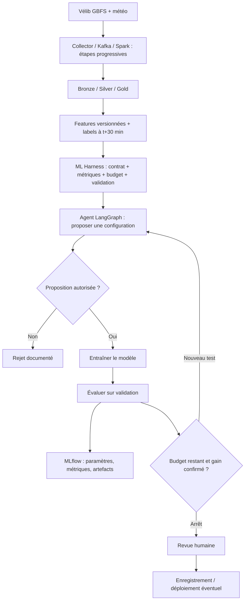

# 02 — Architecture cible du ML harness et de l'agent itératif

**Statut :** design proposé ; aucun agent n'est encore exécuté.

## 1. Pourquoi un harness ?

Un **harness ML** est l'ensemble des outils, règles, contrôles, ressources et interfaces à travers lesquels un agent peut conduire une expérience ML. Il n'est pas un modèle d'IA. Il délimite **ce que l'agent peut faire, voir et modifier**.

Analogie : l'agent est le pilote qui propose une manœuvre ; le harness est l'avion équipé d'instruments, de limites et de procédures de sécurité.

## 2. Flux de bout en bout

**Précision :** les blocs Kafka, Spark et Lakehouse ne sont pas des prérequis pour une première baseline. Le harness consommera d'abord une table de features locale correctement validée.

## 3. Trois piliers du harness

### 3.1 Métriques spécifiques

- Type de problème : classification binaire d'un état futur.
- `primary_metric`: average precision sur validation chronologique.
- Contraintes secondaires : rappel minimal éventuel, latence d'inférence, calibration, performance par segment.
- Tests : apprentissage sur train uniquement, évaluation sur validation, test final verrouillé.

### 3.2 Bonnes pratiques de feature engineering

- Transformations apprises (`fit`) uniquement sur train.
- Transformations réappliquées identiquement sur validation et test à travers `Pipeline` scikit-learn ou adaptateur skrub.
- Features temporelles calculées strictement à partir du passé.
- Interdiction du target leakage : aucune donnée postérieure à `t` en entrée.
- Contrats de schéma, valeurs nulles, dates UTC, stations inconnues, duplications.

### 3.3 Contraintes de déploiement

- Profil « local-first », CPU et RAM limités, budget et délais plafonnés.
- Modèle sérialisable avec dépendances identifiées ; option d'inférence via une API FastAPI plus tard.
- Tests de temps de réponse et de compatibilité avant toute promotion.
- Approbation humaine avant déploiement ; aucune modification automatique de `main`.

## 4. Outils autorisés à l'agent — future API du harness

| Outil | Action et restrictions |
|---|---|
| `describe_dataset()` | Résumé agrégé des colonnes et données manquantes, jamais des secrets |
| `build_features(config)` | Génère uniquement des transformations autorisées et temporellement sûres |
| `train_model(config)` | Lance un entraînement dans une enveloppe de ressources |
| `evaluate_model(run_id)` | Retourne les métriques de validation et diagnostics |
| `compare_runs(ids)` | Compare aux baselines et aux essais antérieurs |
| `propose_next_trial()` | Produit une proposition structurée avec justification |
| `stop_experiment()` | Arrête à budget atteint ou sans gain défendable |

À l'étape initiale, `propose_next_trial()` sera **à règles déterministes**, avant ajout d'un raisonnement LLM optionnel. Ne pas présenter une boucle déterministe comme un agent LLM autonome.

## 5. Boucle d'amélioration attendue

1. Charger le contrat expérimental.
2. Calculer la baseline ; consigner le résultat.
3. Diagnostiquer, par exemple, un rappel faible ou un surapprentissage.
4. Proposer **une** intervention autorisée (lags, pondération de classes, seuil, famille de modèles, hyperparamètres).
5. Valider la proposition (schéma, fuite, budget, reproductibilité).
6. Réentraîner, mesurer, comparer et enregistrer la justification.
7. Conserver le meilleur modèle **selon validation**, arrêter sur les limites définies.
8. Évaluer une fois sur test gelé, publier un rapport critique et soumettre toute promotion à revue humaine.

## 6. Garanties de sécurité et de reproductibilité

- Pas de shell arbitraire ni d'exécution libre de code généré par LLM sur l'ordinateur hôte.
- Configurations structurées et listes blanches de transformations.
- Pas d'accès aux identifiants GitHub ni aux tokens dans les outils de l'agent.
- Docker ou processus isolés, quotas mémoire/CPU/temps, arrêt des expériences.
- Checkpoints d'état, logs sans secrets, version des prompts et des modèles LLM utilisés.
- Le LLM peut proposer une hypothèse : **le validateur et les métriques décident**, pas le texte convaincant du LLM.

## 7. Implémentation cible indicative (non installée)

- Orchestration de l'agent : LangGraph.
- Recherche AutoML comparative : FLAML ; AutoGluon en benchmark optionnel.
- Prétraitement : scikit-learn + skrub en expérimentation contrôlée.
- Évaluation : scikit-learn ; skore en option d'analyse ; MLflow pour les runs.
- Optimisation bornée : Optuna si utile.
- Servir le modèle : FastAPI, ultérieurement.

Sources :
- https://docs.langchain.com/oss/python/langgraph/overview
- https://skrub-data.org/stable/documentation.html
- https://www.mlflow.org/docs/latest/ml/tracking
- https://scikit-learn.org/stable/common_pitfalls.html
