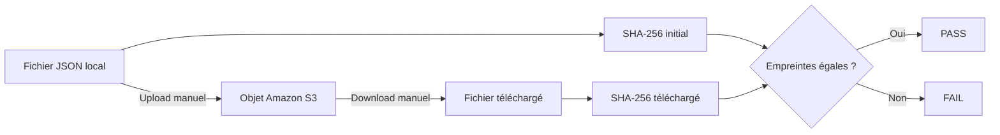

# 01 — Validation du stockage sur Amazon S3

**Projet :** Grand Paris Mobility Lakehouse & Autonomous ML Lab

**Statut :** PASS — test manuel de stockage et de restitution d'un petit objet JSON

**Date de documentation :** 2026-11-17

## 1. Scénario et problème à résoudre

Avant d'automatiser la collecte de données Vélib', il faut vérifier que notre stockage objet distant permet d'enregistrer un fichier et de le récupérer sans altération du contenu.

Cette expérience constitue un **smoke test de stockage**, et non un test de pipeline de données, de montée en charge ou de disponibilité d'Amazon S3.

## 2. Hypothèse et critère d'acceptation

**Hypothèse H-S3-01 :** un petit fichier JSON synthétique transféré manuellement vers un objet S3, puis téléchargé, conserve exactement son contenu.

**Critère PASS :** les empreintes SHA-256 calculées localement avant et après transfert sont identiques. Le test échoue si les empreintes diffèrent, si un transfert échoue ou si un des fichiers est introuvable.

## 3. Environnement et périmètre

| Élément | Observation |
| --- | --- |
| Poste de développement | Windows 11 ; PowerShell |
| Stockage distant | Amazon S3 (service réel) |
| Région | `eu-north-1` (Europe — Stockholm) |
| Bucket | Compartiment du projet, nom exact non publié ici |
| Clé de l'objet | `bronze/s3-smoke-test.json` |
| Données | Petit document JSON synthétique, sans données personnelles |
| Mode de transfert | AWS Console : chargement et téléchargement manuels |
| Comparaison | `Get-FileHash`, algorithme SHA-256 |

**Précaution :** ce test ne démontre pas encore l'accès par AWS CLI, boto3, IAM ou un collecteur automatisé.

## 4. Principe du test



Une **empreinte SHA-256** est un résumé calculé à partir des octets d'un fichier. L'égalité des empreintes constitue une preuve pratique forte d'identité du contenu, mais ne vérifie ni l'identité de l'expéditeur ni l'authenticité métier de la source.

## 5. Protocole réalisé

1. Créer un petit fichier JSON synthétique sur le poste local.
2. Dans la console Amazon S3, ouvrir le bucket du projet et charger le fichier sous la clé `bronze/s3-smoke-test.json`.
3. Vérifier que la console annonce un chargement réussi.
4. Télécharger l'objet depuis S3 vers un autre chemin local, sans écraser l'original.
5. Calculer les empreintes SHA-256 des deux fichiers et les comparer dans PowerShell.

Exemple de commande de comparaison, à adapter aux chemins réels :

```powershell
$original = Get-FileHash ".\data\validation\s3-smoke-test.json" -Algorithm SHA256
$downloaded = Get-FileHash "$HOME\Downloads\s3-smoke-test.json" -Algorithm SHA256
$original.Hash -eq $downloaded.Hash
```

Les chemins locaux ne sont pas des chemins S3. Dans S3, `bronze/` est un **préfixe de clé d'objet**, pas un répertoire de système de fichiers traditionnel.

## 6. Résultats observés

| Vérification | Résultat rapporté |
| --- | --- |
| Chargement dans S3 | Succès, 1 fichier, 0 erreur (console) |
| Téléchargement de l'objet | Effectué |
| Comparaison SHA-256 | `True` |
| Verdict du test H-S3-01 | **PASS** |

Les valeurs hexadécimales exactes des deux empreintes n'ont pas été consignées dans ce rapport. Le résultat `True` provient de la comparaison exécutée sur le poste de développement. Il ne faut pas présenter ce test comme une mesure de débit, de latence ou de durabilité.

## 7. Limites et risques

- Un seul petit fichier synthétique a été testé ; aucune répétition statistique ni aucun fichier volumineux.
- Les opérations ont été exécutées manuellement dans AWS Console : **aucun pipeline automatique n'est encore implémenté**.
- La comparaison SHA-256 vérifie l'identité du contenu, pas la pertinence ou la qualité des données.
- Aucun test d'échec réseau, de droits IAM restrictifs, de reprise automatique ni de concurrence d'écriture.
- Les coûts AWS et les paramètres de sécurité doivent être suivis séparément.
- Ce test ne constitue pas une validation de Delta Lake, du schéma Bronze/Silver/Gold ou des données Vélib'.

## 8. Reproductibilité, confidentialité et suite

Le fichier synthétique de l'expérience est conservé localement dans `data/validation/` et exclu du suivi Git par `.gitignore`. Aucune clé AWS, aucun identifiant personnel ni aucune valeur sensible ne doit être ajouté au dépôt.

**Prochaine expérience :** configurer un accès AWS à privilèges minimaux, installer ou vérifier AWS CLI et boto3, puis reproduire l'aller-retour S3 depuis Python avec des tests automatisés et des sorties d'expérience conservées localement.

## Références

- [AWS — Chargement d'objets dans Amazon S3](https://docs.aws.amazon.com/AmazonS3/latest/userguide/upload-objects.html)
- [AWS — Vérification de l'intégrité des objets](https://docs.aws.amazon.com/AmazonS3/latest/userguide/checking-object-integrity.html)
- [AWS — Organisation des objets à l'aide des préfixes](https://docs.aws.amazon.com/AmazonS3/latest/userguide/using-prefixes.html)
