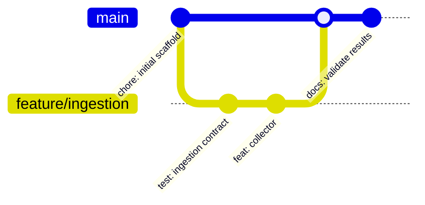

# 01 — Workflow Git / GitHub du projet

## Modèle

- `main` : état intégré et vérifié.
- `feature/xxx` : modification isolée (ingestion, schema, tests, documentation...).
- **Pull Request (PR)** : discussion des changements, tests, justification, revue, fusion dans `main`.
- **Commit** : point d'historique cohérent et descriptif ; **Push** : copie des commits vers le dépôt distant.
- **Pull** : récupération et intégration des modifications distantes.
- **Fork** : copie d'un dépôt externe, utile pour contribuer à un autre projet ; inutile pour notre dépôt original.

Ce schéma est **illustratif** : ses commits autres que le premier n'existent pas encore.

## Commandes et signification

| Commande | Fonction |
|---|---|
| `git status` | Détecter les fichiers non suivis ou modifiés |
| `git diff` | Relire les modifications non préparées |
| `git add <fichier>` | Placer un changement dans la zone de préparation (*staging*) |
| `git diff --cached` | Relire ce qui sera inclus dans le commit |
| `git commit -m "..."` | Enregistrer un état local dans l'historique |
| `git push` | Envoyer les commits sur le serveur GitHub |
| `git pull --ff-only` | Récupérer les changements et n'avancer que sans fusion ambiguë |
| `git switch -c feature/...` | Créer une branche de travail |

## Bonnes pratiques

- Ne jamais committer `.env`, mots de passe, tokens, rapports privés ou jeux de données volumineux.
- Ne pas inventer de tests réussis ou de mesures ; joindre les preuves.
- Relire `git status` et `git diff --cached` avant chaque commit.
- Ajouter les sources et limites aux figures et aux résultats.
- Utiliser des messages : `docs: ...`, `feat: ...`, `fix: ...`, `test: ...`, `chore: ...`.
